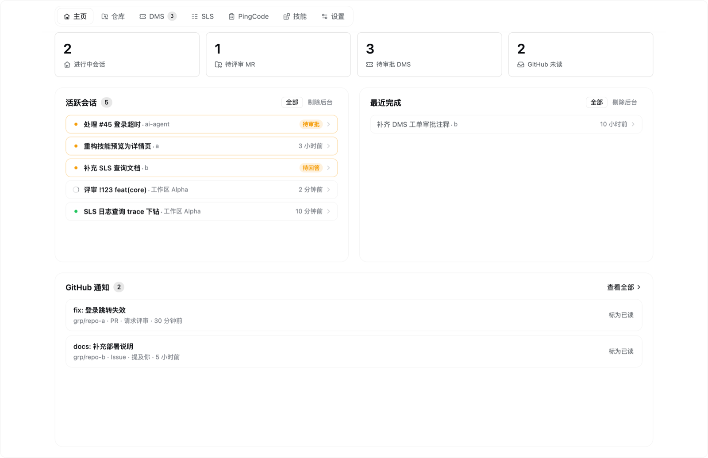
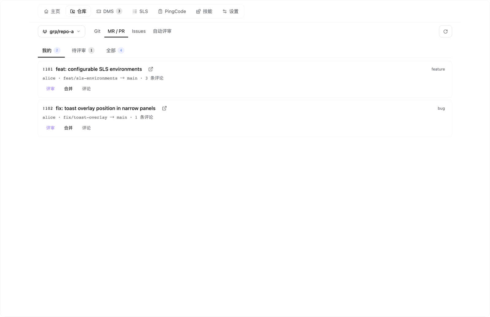
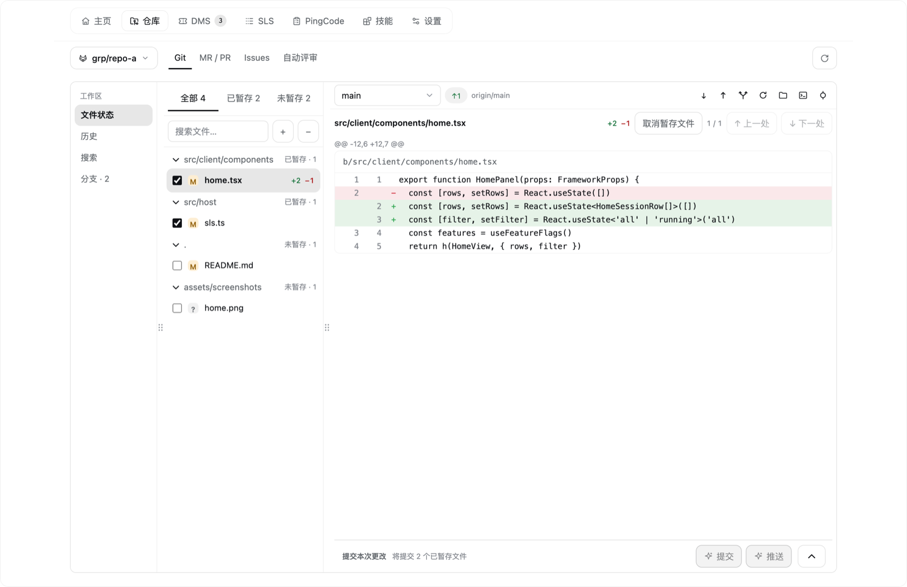
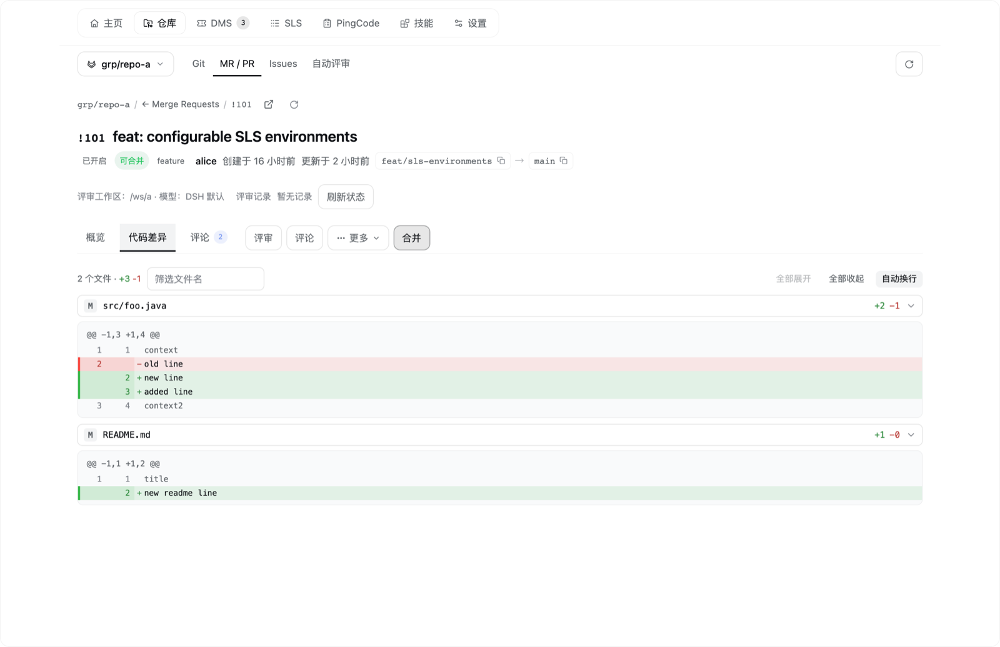
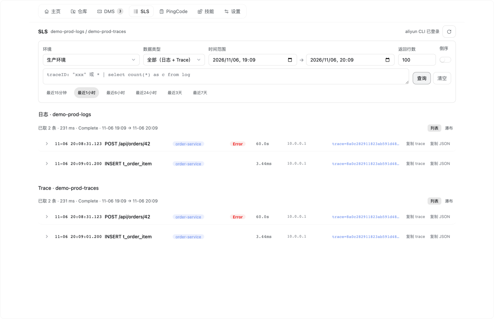
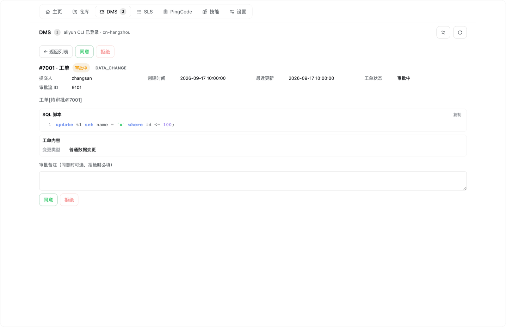

English | [中文](README.zh.md)

# dsh-workbench

A workbench for the DeepSeek Harness (DSH) Web UI: one sidebar entry that brings local Git, GitLab MRs / GitHub PRs and their Issues, Aliyun DMS ticket approvals, Aliyun SLS log queries, PingCode work items and skills management into a single panel — driven entirely by the CLIs already installed and logged in on your machine.

[](https://github.com/samanhappy/dsh-workbench/actions/workflows/ci.yml)
[](https://www.npmjs.com/package/@samanhappy/dsh-workbench)
[](LICENSE)


The plugin is a static bundle: the host half registers same-origin routes that run local CLIs, and the client half renders the panel inside DSH. It stores no credentials and does not interfere with your sessions — no dynamic runner, no approval, no steering.

## Screenshots

Demo data only — no real accounts, repositories or tickets are shown.

| Home | Repository · MR/PR |
| :-: | :-: |
|  |  |
| **Local Git** | **Code review (MR detail)** |
|  |  |
| **Aliyun SLS logs** | **Aliyun DMS approvals** |
|  |  |

## Features

### Workbench

| Page | What you get |
| --- | --- |
| Home | Default landing page: cross-workspace sessions that need your attention (running / pending / active in the last 24 h), stat cards for running sessions, MRs awaiting review, pending DMS approvals and unread GitHub notifications, plus the latest unread notifications. |
| Repository | One page with a **Git \| MR/PR \| Issues \| Auto-review** sub-navigation; workspace and platform are detected automatically from the Git remote. |
| Git | Local changes (staged / unstaged / conflicts) with diff preview, staging, commit (including AI-generated commit messages with a configurable model and language), history graph with search, branches / tags / remotes, checkout, create / rename / delete branch, merge, pull (fast-forward only), push (never force) and commit-and-push. |
| MR / PR | My / To review / All lists, detail with the full diff, one-click AI review in a fresh session, per-repository background auto-review, approve, merge (optionally squash / delete the source branch), comment, close and open in the browser. |
| Issues | Whole-repository issue list with search, labels, assignee, state, sort and pagination; detail with comments and related MRs; edit; batch close / reopen; "Handle" starts a fresh session that analyses the issue first. |
| Assistant message actions | "Submit MR/PR" on a finalized assistant message creates the MR/PR in the current session; "Git" opens the commit dialog for the workspace. |
| Notifications | GitHub unread notifications across repositories; opening one marks it read and links to GitHub. The list has no top-level tab — the Home page is its entry point. |
| Skills | Browse installed skills from DSH's skill roots, read SKILL.md and referenced support files (highlighted code, CSV tables, images), enable / disable, uninstall, check for updates; search skills.sh and install with one click. |
| Settings | Per-user feature toggles, sidebar shortcut selection, review model, Git commit language, and editable prompts for review, Issue handling, Git commits and MR/PR submission. |

Feature toggles are per user and per browser: closing a page hides its entry points and stops loading its data. This is a UI and request trim, not a permission boundary.

### Optional integrations

Nothing below is required to install or use the workbench. Each integration is only contacted while the corresponding page or action is used; a missing CLI shows an in-page hint instead of breaking the rest of the panel.

| Integration | Powers | Requires |
| --- | --- | --- |
| GitLab / GitHub | Repository MR/PR, Issues, auto-review, GitHub notifications | `glab` and / or `gh` installed and logged in; network access to the instance. A self-hosted GitLab must be known to `glab auth status`. |
| Aliyun DMS | Ticket approval, order detail and SQL | `aliyun` CLI logged in; RAM read + approval permissions. Region (and `Tid` for multi-tenant accounts) can be set in the page. |
| Aliyun SLS | Log and trace queries, SQL / JSON detail, trace drill-down and waterfall | `aliyun` CLI logged in; RAM log-read permission; target Project / Logstore with indexes configured; `slsEnvironments` set in the plugin row config (no default project). Aliyun service — available in supported Aliyun regions. |
| PingCode | Read-only work items, comments and filters | `python3` plus a local `pingcode` skill directory containing `scripts/api_call.py` and a configured `.env`. |
| skills.sh | Install / update / discover skills | `node` + `npx` (first run fetches the skills package over the network). Listing and previewing local skills works without it. |

## Install

DSH must be installed (`dsh` on `PATH`). Install the plugin with one of the following:

```bash
# 1. npm (recommended)
dsh plugin --profile web add @samanhappy/dsh-workbench

# 2. GitHub
dsh plugin --profile web add github:samanhappy/dsh-workbench

# 3. Local checkout
dsh plugin --profile web add /path/to/dsh-workbench
```

The npm form requires that version to be published; the GitHub and local-checkout forms do not. The package ships prebuilt `index.js` (host half) and `lib/client.js` (client half), so consumers need no build step. `dsh plugin` links the package into the profile and appends it to the bundle list; **restart DSH** to activate it. The first launch adds a **Workbench** entry to the sidebar; opening it lands on the Home page.

Optional integrations are configured individually (install and log in the CLIs above). SLS ships with no default project: set `slsEnvironments` in the plugin row's config in your DSH profile. See [docs/installation.md](docs/installation.md) for a YAML example and full setup steps.

## Requirements & compatibility

- **DSH**: tested against the `0.2.2-rc.1` desktop app; the plugin is built against the public `@deepseek-ai/dsh-client-ui-*` `0.1.6-alpha.2` contract packages. Newer versions may work, but DSH UI extension points can change.
- **OS**: macOS and Linux are the tested targets; Windows is untested.
- **Node.js**: not required to use the plugin (the client and host bundles are prebuilt). Development needs Node.js `>= 22.15.0`; the Skills page's install / update / search needs a local Node.js with `npx` (the project's tested baseline is `22.15.0`).
- **CLIs**: needed only for the optional integrations above — each must be installed and logged in with your own account.
- **Tests**: the development test suite is POSIX-only (it relies on `chmod` and symlinks), so development on Windows is not supported.

## Security & privacy

- **No credentials are stored.** The plugin reads data through the CLIs you already logged in (`git`, `glab`, `gh`, `aliyun`, `npx skills`) and, for PingCode, through that skill's own `.env`. It never persists tokens.
- **Same-origin routes.** Everything is registered on DSH's own web server behind DSH's Host / Origin + login-cookie trust fence; the plugin opens no new port or listener.
- **Trusted static client code.** The client bundle runs without per-action approval — install only packages you trust.
- **Do not expose the DSH Web UI to untrusted networks.** Anyone who can load the page can drive the local CLIs through it with your logged-in permissions.
- **Real writes happen only when you trigger them**: DMS approvals, Git pushes, MR/PR merges / closes / comments, skill install / uninstall and edits to skill files.
- The Home page reads DSH's own session storage files. That format is not an official contract; parsing failures degrade gracefully instead of breaking the page.

See [SECURITY.md](SECURITY.md) for how to report vulnerabilities.

## Development

Node.js `>= 22.15.0` and npm:

```bash
npm install
npm run build             # src/host → index.js; src/client → lib/client.js
npm run typecheck:setup   # install pinned public DSH contract packages (--no-save)
npm run typecheck
npm test                  # node --test; rebuilds first
npm run sim               # stubbed client-half behavior simulation
npm run smoke             # host-half smoke test against real, logged-in CLIs
```

- `index.js` and `lib/client.js` are committed build artifacts. Run `npm run build` after any change under `src/` and commit the regenerated files; CI rebuilds them and checks byte-for-byte reproducibility.
- Tests load the built artifacts, so build before asserting; `npm run sim` uses a stubbed client environment.
- `npm run smoke` needs `glab` / `gh` / `aliyun` logged in and is not suitable for CI.

Contributions are welcome — see [CONTRIBUTING.md](CONTRIBUTING.md); report security issues as described in [SECURITY.md](SECURITY.md).

## Docs

| Document | Answers |
| --- | --- |
| [docs/architecture.md](docs/architecture.md) | The two halves, request and state flow, extension points |
| [docs/conventions.md](docs/conventions.md) | Invariants and contracts (safety, caching, config registry, review / handle flows, platform semantics) |
| [docs/features.md](docs/features.md) | What each page can do |
| [docs/usage.md](docs/usage.md) | What you see and how it behaves |
| [docs/limitations.md](docs/limitations.md) | Known limitations and why |
| [docs/commands.md](docs/commands.md) · [docs/installation.md](docs/installation.md) | Build / test, and install / update / troubleshoot |

> **Code is the single fine-grained source of truth.** The docs only carry what cannot be inferred from the source, or what breaks if someone gets it wrong: purpose and boundaries, external contracts and invariants, flow semantics, extension points, known limitations and operational steps. The rule is in [AGENTS.md](AGENTS.md).

## License

MIT © 2026 samanhappy. See [LICENSE](LICENSE). Bundled or adapted third-party components and their license texts are listed in [THIRD_PARTY_NOTICES.md](THIRD_PARTY_NOTICES.md) (dsh-git-tree, DSH diff rendering, jsdiff, Lucide / Phosphor / Simple Icons / Git logo).

## Not affiliated

This is an independent community project. It is not affiliated with, endorsed by, or supported by DeepSeek, Aliyun, PingCode, GitLab or GitHub. DSH, Aliyun, PingCode, GitLab and GitHub are trademarks of their respective owners.

This project is also **not** the unscoped npm package `dsh-workbench` (by lee259); install the scoped package `@samanhappy/dsh-workbench`.
