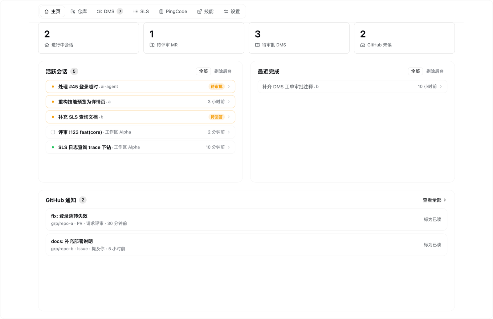
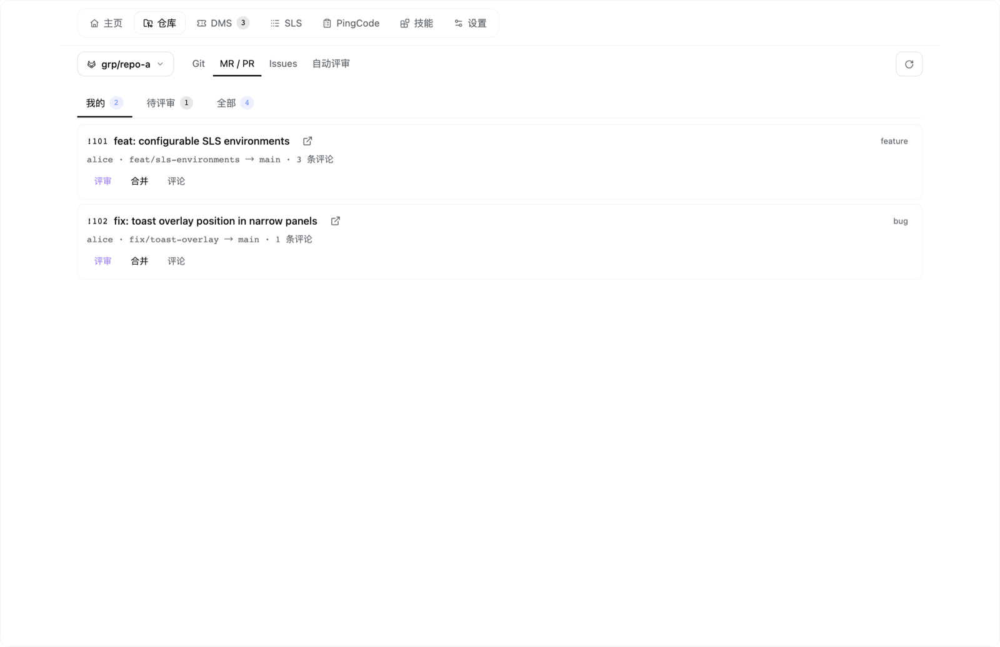
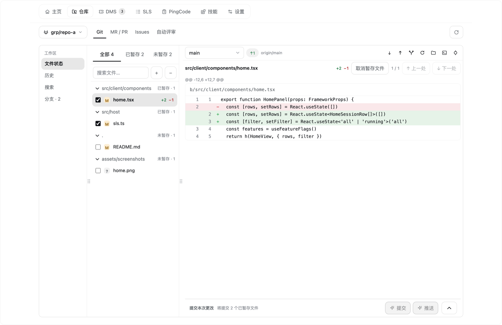
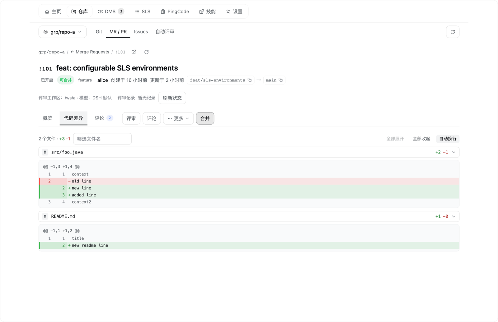
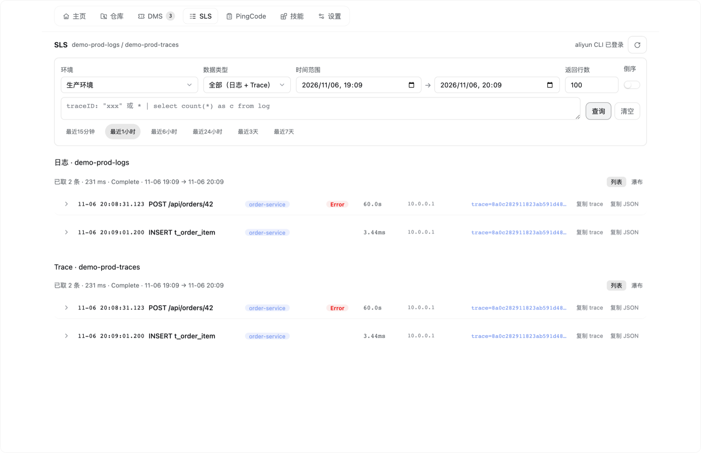
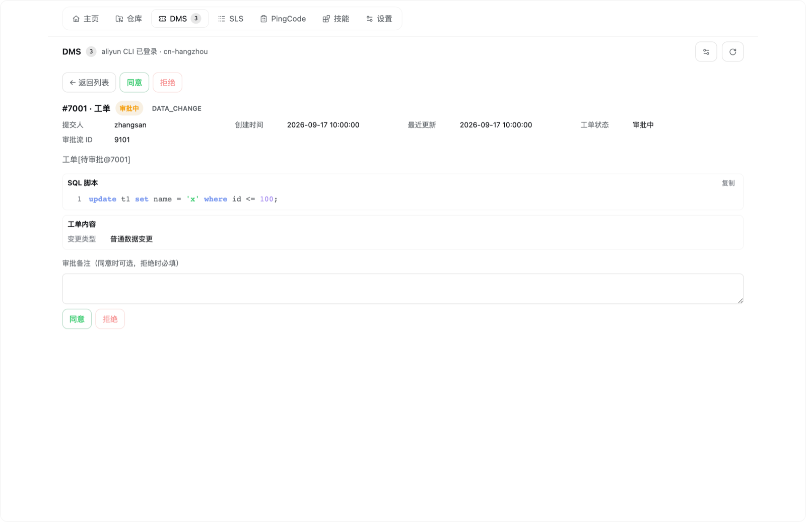

[English](README.md) | 中文

# dsh-workbench

DeepSeek Harness（DSH）Web 界面的工作台：左侧边栏一个入口，把本地 Git、GitLab MR / GitHub PR 及其 Issues、阿里云 DMS 工单审批、阿里云 SLS 日志查询、PingCode 工作项与技能管理收进同一个面板——全部数据来自你本机已安装、已登录的 CLI。

[](https://github.com/samanhappy/dsh-workbench/actions/workflows/ci.yml)
[](https://www.npmjs.com/package/@samanhappy/dsh-workbench)
[](LICENSE)


插件是一个静态 bundle：host 半注册同源路由并调用本机 CLI，client 半在 DSH 内渲染面板。插件不保存任何凭据，也不干预你的会话——没有动态 runner、审批或 steering。

## 界面截图

截图使用演示数据，不含真实账号、仓库或工单。

| 首页 | 仓库 · MR/PR |
| :-: | :-: |
|  |  |
| **本地 Git** | **代码评审（MR 详情）** |
|  |  |
| **阿里云 SLS 日志** | **阿里云 DMS 审批** |
|  |  |

## 功能

### 工作台

| 页面 | 能力 |
| --- | --- |
| 首页 | 默认落地页：跨工作区「需要我关注」的会话（进行中 / 待处理 / 近 24h 活跃）、进行中会话 / 待评审 MR / 待审批 DMS / GitHub 未读统计卡，以及最近未读通知。 |
| 仓库 | 同一页内的 **Git \| MR/PR \| Issues \| 自动评审** 二级导航；工作区与平台由 Git remote 自动识别。 |
| Git | 本地改动（已暂存 / 未暂存 / 冲突）与 diff 预览、暂存、提交（含 AI 生成提交信息，模型与语言可配置）、提交历史图与搜索、分支 / 标签 / 远端、检出、新建 / 重命名 / 删除分支、合并、拉取（仅快进）、推送（绝不用 force）与提交并推送。 |
| MR / PR | 我的 / 待评审 / 全部列表，详情含完整 diff，一键在新会话里做 AI 评审，按仓库开启后台自动评审，批准、合并（可选 squash / 删除源分支）、评论、关闭、在浏览器打开。 |
| Issues | 全仓库 Issue 列表（搜索、标签、负责人、状态、排序、分页），详情含评论与关联 MR，编辑，批量关闭 / 重新打开；「处理」会在新会话里先分析确认问题。 |
| 助手消息按钮 | 定稿的助手消息上有「提交 MR/PR」（在当前会话里创建），以及「Git」（打开该工作区的提交弹窗）。 |
| 通知 | 跨仓库的 GitHub 未读通知；打开即标为已读并跳转 GitHub。通知列表不设顶级页签，入口在首页。 |
| 技能管理 | 浏览 DSH 技能根下已安装的技能，只读查看 SKILL.md 与其引用的支持文件（代码高亮、CSV 表格、图片），停用 / 启用、卸载、检查更新；搜索 skills.sh 并一键安装。 |
| 配置 | 按人定制：功能开关、菜单栏快捷入口、评审模型、Git 提交信息语言，以及评审 / Issue 处理 / Git 提交 / 提交 MR·PR 的提示词。 |

功能开关按使用者、按浏览器生效：关闭某个功能后，对应入口消失、也不再加载该域数据。它只是界面与请求裁剪，不是权限边界。

### 可选集成

以下集成都不是安装或使用工作台的前提。只有用到对应页面或操作时才会调用相应 CLI；CLI 缺失时页面内会给出提示，不影响其余面板。

| 集成 | 提供什么 | 需要 |
| --- | --- | --- |
| GitLab / GitHub | 仓库 MR/PR、Issues、自动评审、GitHub 通知 | 已安装并登录 `glab` 和 / 或 `gh`；可访问对应实例。自建 GitLab 需出现在 `glab auth status` 中。 |
| 阿里云 DMS | 工单审批、工单详情与 SQL | 已登录 `aliyun` CLI；RAM 只读 + 审批权限。面板内可设置 Region（多租户账号还可设置 `Tid`）。 |
| 阿里云 SLS | 日志与 Trace 查询、SQL / JSON 详情、trace 下钻与瀑布 | 已登录 `aliyun` CLI；RAM 日志只读权限；目标 Project / Logstore 已开通并配置索引；需在插件行配置里设置 `slsEnvironments`（没有默认 Project）。阿里云服务，仅限已开通的地域。 |
| PingCode | 只读工作项、评论与筛选 | `python3` 与本机 `pingcode` 技能目录（含 `scripts/api_call.py` 与已配置的 `.env`）。 |
| skills.sh | 安装 / 更新 / 发现技能 | `node` + `npx`（首次运行需联网拉取 skills 包）。仅浏览与预览本机技能时不需要。 |

## 安装

需已安装 DSH（`dsh` 在 `PATH` 上）。三选一：

```bash
# 1. npm（推荐）
dsh plugin --profile web add @samanhappy/dsh-workbench

# 2. GitHub
dsh plugin --profile web add github:samanhappy/dsh-workbench

# 3. 本地目录
dsh plugin --profile web add /path/to/dsh-workbench
```

npm 形式要求对应版本已发布到 npm；GitHub 与本地目录形式不依赖发布。包内已带预构建的 `index.js`（host 半）与 `lib/client.js`（client 半），使用者无需构建。`dsh plugin` 会把包链接进 profile 并追加到 bundle 列表；**重启 DSH** 后生效。首次打开时左侧边栏出现「工作台」入口，默认落在首页。

可选集成需各自安装并登录对应 CLI。SLS 没有内置默认 Project：请在你 DSH profile 的插件行配置里设置 `slsEnvironments`。YAML 示例与完整步骤见 [docs/installation.md](docs/installation.md)。

## 环境要求与兼容性

- **DSH**：在 `0.2.2-rc.1` 桌面版上测试；插件基于公开的 `@deepseek-ai/dsh-client-ui-*` `0.1.6-alpha.2` 契约包构建。更新版本可能可用，但 DSH 的界面扩展点可能变化。
- **操作系统**：macOS 与 Linux 是已测试目标；Windows 未测试。
- **Node.js**：使用插件本身不需要（前后端产物已预构建）。开发需要 Node.js `>= 22.15.0`；技能页的安装 / 更新 / 搜索需要本机有带 `npx` 的 Node.js（项目测试基线为 `22.15.0`）。
- **CLI**：仅上面的可选集成需要，且都必须用你自己的账号安装并登录。
- **测试**：开发测试套件仅支持 POSIX（依赖 `chmod` 与符号链接），不支持在 Windows 上开发。

## 安全与隐私

- **不保存凭据。** 插件通过你已登录的 CLI（`git`、`glab`、`gh`、`aliyun`、`npx skills`）读取数据；PingCode 的凭据在技能自己的 `.env` 里。插件从不持久化 token。
- **同源路由。** 所有路由都注册在 DSH 自己的 Web 服务上，沿用 DSH 的 Host / Origin + 登录 Cookie 信任围栏；插件不新开端口或监听。
- **客户端是按包分发的受信静态代码。** 没有逐操作审批——请只安装你信任的包。
- **不要把 DSH Web 暴露给不可信网络。** 能打开页面的人，就能以你已登录的权限驱动本机 CLI。
- **真实写操作只在你触发时发生**：DMS 审批、Git 推送、MR/PR 合并 / 关闭 / 评论、技能安装 / 卸载与技能文件编辑。
- 首页直接读取 DSH 自身的会话存储文件；该格式不是官方契约，解析失败时只会降级，不会让页面报错。

漏洞报告方式见 [SECURITY.md](SECURITY.md)。

## 开发

需要 Node.js `>= 22.15.0` 与 npm：

```bash
npm install
npm run build             # src/host → index.js；src/client → lib/client.js
npm run typecheck:setup   # 安装固定版本的公开 DSH 契约包（--no-save）
npm run typecheck
npm test                  # node --test；会先自动构建
npm run sim               # 客户端行为模拟（stub 环境）
npm run smoke             # host 半对真实、已登录 CLI 的冒烟测试
```

- `index.js` 与 `lib/client.js` 是已提交的构建产物。改动 `src/` 后必须 `npm run build` 并提交重新生成的文件；CI 会重新构建并校验逐字节可复现。
- 测试加载构建后的产物，先构建再跑断言；`npm run sim` 使用 stub 环境。
- `npm run smoke` 需要已登录的 `glab` / `gh` / `aliyun`，不适合放进 CI。

欢迎贡献，见 [CONTRIBUTING.md](CONTRIBUTING.md)；安全问题请按 [SECURITY.md](SECURITY.md) 报告。

## 文档

| 文档 | 回答什么 |
| --- | --- |
| [docs/architecture.md](docs/architecture.md) | 插件由哪两半组成、请求与状态怎么流动、要扩展该动哪里 |
| [docs/conventions.md](docs/conventions.md) | 必须守住的不变量与对外契约（安全、缓存、配置注册表、评审 / 处理流程、平台语义） |
| [docs/features.md](docs/features.md) | 每个页面能做什么 |
| [docs/usage.md](docs/usage.md) | 用起来会看到什么行为 |
| [docs/limitations.md](docs/limitations.md) | 已知限制与原因 |
| [docs/commands.md](docs/commands.md) · [docs/installation.md](docs/installation.md) | 构建 / 测试，以及安装、更新与排障 |

> **代码是唯一的细粒度事实来源。** 文档只写源码推不出来、或改错会出事的内容：定位与边界、外部契约与不变量、流程语义、扩展点、已知限制与操作步骤。规则见 [AGENTS.md](AGENTS.md)。

## 许可证

MIT © 2026 samanhappy，见 [LICENSE](LICENSE)。随包分发或改编的第三方组件及其许可证全文见 [THIRD_PARTY_NOTICES.md](THIRD_PARTY_NOTICES.md)（dsh-git-tree、DSH diff 渲染、jsdiff、Lucide / Phosphor / Simple Icons / Git logo）。

## 非官方声明

这是一个独立的社区项目，与 DeepSeek、阿里云、PingCode、GitLab 或 GitHub 没有隶属、背书或支持关系。DSH、阿里云、PingCode、GitLab、GitHub 是各自权利人的商标。

本项目**不是** lee259 发布的未加 scope 的 npm 包 `dsh-workbench`；请安装带 scope 的 `@samanhappy/dsh-workbench`。
